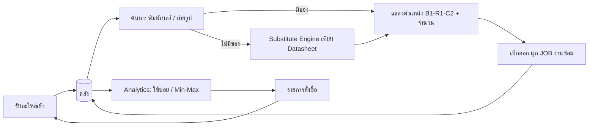
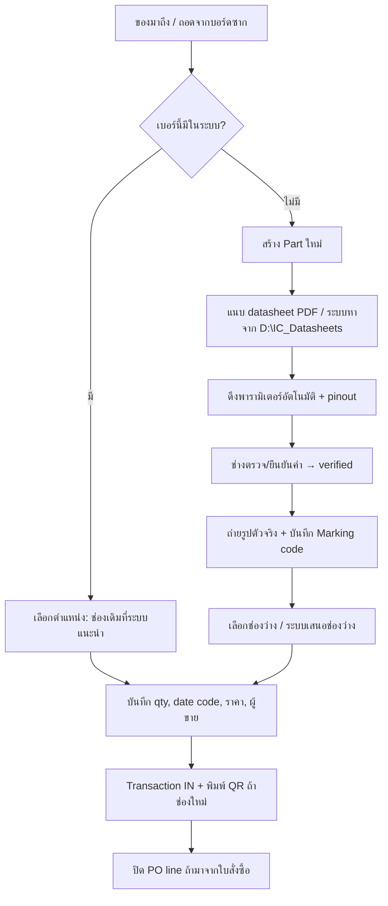
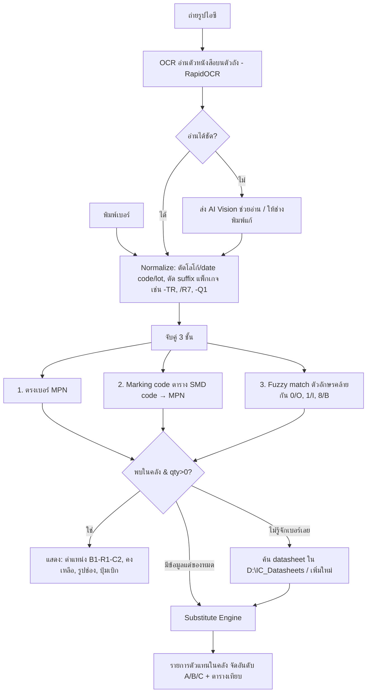
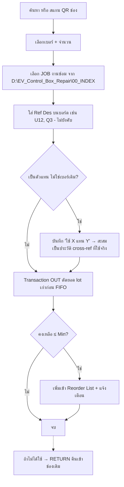
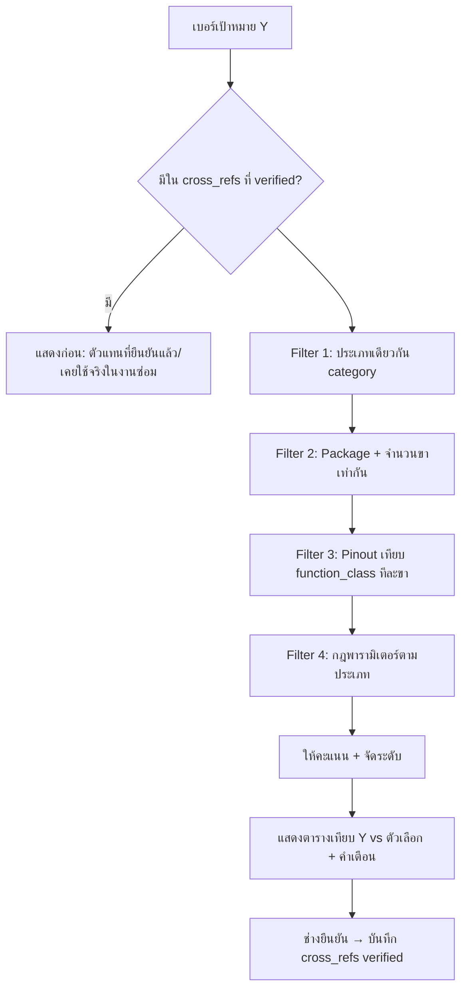

# IC Storage — แผนการสร้างและ Flow การทำงาน (Design v0.1)

> ระบบคลังคอมโพเนนต์/ไอซี สำหรับงานซ่อมบอร์ดกล่องควบคุมรถ EV
> สถานะ (2026-10-14): **เฟส 1 บางส่วนสร้างแล้ว** — สแกนรับของ (LCSC QR / Digikey-Mouser DataMatrix / OCR), จัดลิ้นชักอัตโนมัติ,
> แผนผังตู้ A (6×6), ป้าย QR, ค้นหา, เบิก FIFO, Export Excel — วิธีใช้: `01_วิธีใช้_จัดคลังครั้งแรก.md`

---

## 1. เป้าหมายของระบบ

| # | ความสามารถ | ผลลัพธ์ที่ต้องได้ |
|---|---|---|
| 1 | บันทึกข้อมูลอะไหล่ | เบอร์ (MPN), ยี่ห้อ, แพ็กเกจ, Marking code, ประเภท, พารามิเตอร์หลัก, datasheet, รูป |
| 2 | ตำแหน่งจัดเก็บ | รู้ทันทีว่าอยู่ **กล่อง/แถว/ช่อง** ไหน (เช่น `B1-R1-C2`) พร้อม QR ติดช่อง |
| 3 | รับเข้า / เบิกออก (ตัดสต๊อก) | ทุกการเคลื่อนไหวเป็น Transaction ผูกกับ **JOB งานซ่อม** |
| 4 | แจ้งสั่งซื้อ | เมื่อคงเหลือ ≤ Min → เข้ารายการสั่งซื้อ อัตโนมัติ พร้อมจำนวนที่ควรสั่ง (เติมถึง Max) |
| 5 | วิเคราะห์การใช้ | ตัวไหนใช้บ่อยสุด, ใช้กับรถ/กล่องอะไร, คำนวณ Min/Max จากสถิติจริง |
| 6 | ค้นหาด้วยเบอร์หรือรูป | พิมพ์เบอร์ / ถ่ายรูปตัวไอซี → OCR อ่านตัวหนังสือบนตัวถัง → หาในคลัง |
| 7 | เทียบ Datasheet / หาตัวแทน | ถ้าไม่มี → เสนอตัวในคลังที่ใช้แทนได้ จัดระดับ A/B/C พร้อมตารางเทียบสเปก + คำเตือน |

---

## 2. สถาปัตยกรรม (แนะนำ)

```
 ┌──────────── มือถือ (ถ่ายรูป/สแกน QR) ─────────┐   ┌──── PC หน้าโต๊ะซ่อม ────┐
 │   Web App (PWA) ผ่าน Wi-Fi ในร้าน              │   │   Web App บน Browser     │
 └──────────────────────┬────────────────────────┘   └────────────┬────────────┘
                        │ HTTP (LAN)                               │
               ┌────────▼──────────────────────────────────────────▼────────┐
               │  Backend: Python FastAPI  (รันบน PC ร้าน, D:\IC_Storage)    │
               │  ├─ Inventory service   (สต๊อก/ตำแหน่ง/Transaction)         │
               │  ├─ Search service      (Normalize + Fuzzy + Marking code)  │
               │  ├─ OCR service         (RapidOCR — มีติดตั้งแล้ว)          │
               │  ├─ Datasheet service   (PyMuPDF ดึงข้อความ+พารามิเตอร์)     │
               │  ├─ Substitute engine   (กฎเทียบสเปก + ตาราง cross-ref)      │
               │  └─ Analytics service   (ABC, Min/Max, Reorder)              │
               └────────┬───────────────────────────────┬───────────────────┘
                        │                               │
          ┌─────────────▼────────────┐    ┌─────────────▼─────────────────────┐
          │ SQLite: ic_storage.db    │    │ ไฟล์: datasheets PDF, รูปอะไหล่,    │
          │ (+ backup รายวัน)        │    │ รูปช่องเก็บ  (D:\IC_Datasheets)    │
          └──────────────────────────┘    └───────────────────────────────────┘
                        │  (ทางเลือก, ต้องมีเน็ต)
               ┌────────▼─────────────────────────┐
               │ AI Vision / LLM (Claude API)      │  ใช้เมื่อ OCR อ่านไม่ออก
               │ + ดึงพารามิเตอร์จาก datasheet     │  หรือช่วยสรุปความต่างสเปก
               └──────────────────────────────────┘
```

**เหตุผลที่เลือก**
- **Local-first**: ทำงานได้แม้เน็ตล่ม, ข้อมูลอยู่ในเครื่องร้าน, SQLite ไฟล์เดียว backup ง่าย
- **Web App** แทนโปรแกรม Desktop: ใช้กล้องมือถือถ่ายไอซี/สแกน QR ช่องเก็บได้โดยไม่ต้องลงแอป
- **Python**: เครื่องมีอยู่แล้ว (`pythoncore-3.14-64`) + PyMuPDF + RapidOCR ติดตั้งแล้ว
- เชื่อมกับ `D:\EV_Brain` และ `D:\EV_Control_Box_Repair` ได้ตรง (เบิกของผูก JOB งานซ่อม)

---

## 3. ระบบตำแหน่งจัดเก็บ (Location Code)

```
 รหัส:  <ตู้/กล่อง>-<แถว>-<ช่อง>[-<ช่องย่อย>]
 ตัวอย่าง:  B1-R1-C2     = กล่อง 1 แถว 1 ช่อง 2
           B3-R4-C10-A  = กล่อง 3 แถว 4 ช่อง 10 ซองย่อย A
```

- ทุกช่องมี **QR Label** (พิมพ์จากระบบ) → สแกนแล้วเปิดหน้าช่องนั้น: มีอะไรอยู่ กี่ตัว
- 1 เบอร์อยู่ได้หลายช่อง (เช่น รีล + ถุงแบ่ง), 1 ช่องใส่ได้หลายเบอร์ (ไม่แนะนำสำหรับ IC หน้าตาคล้ายกัน)
- กล่อง ESD / MSL (ไอซีที่ไวความชื้น) ทำ flag แยก → เตือนให้อบก่อนใช้ถ้าเปิดถุงนาน

---

## 4. โครงสร้างฐานข้อมูล (Data Model)

```
 categories ─┐
             │ 1:N
 parts ──────┼─────────────< part_params        (พารามิเตอร์ normalize: key, value, unit, min/typ/max)
   │         │─────────────< part_aliases       (ชื่อเรียกอื่น, Marking code, เบอร์ที่ตัด suffix)
   │         │─────────────< datasheets         (path PDF, hash, ข้อความที่ดึงได้)
   │         │─────────────< part_pinout        (pin no. → function: VCC, GND, IN+, OUT ...)
   │         └─────────────< cross_refs  >───── parts   (A↔B, ระดับ, verified, หมายเหตุ)
   │
   └─< stock_lots >── locations                 (ยอดคงเหลือต่อช่อง, date code, lot, ราคาทุน)
           │
           └─< transactions >── repair_jobs      (IN / OUT / RETURN / ADJUST / SCRAP)
                                               (ผูก JOB, รถ, กล่อง, ตำแหน่ง Ref Des บนบอร์ด เช่น U12)
 suppliers ─< purchase_orders ─< po_lines >── parts
 stock_policy (part_id, min, max, lead_time_days, critical_flag, method=auto/manual)
```

### ตารางหลัก (ฟิลด์สำคัญ)

| ตาราง | ฟิลด์ |
|---|---|
| **parts** | id, mpn, mpn_normalized, manufacturer, category, package (SOIC-8, TSSOP-20, TO-247…), description, marking_code, aec_q (Q100/Q101/none), temp_grade, rohs, image_path, notes |
| **part_params** | part_id, key (เช่น `vds_max`, `id_cont`, `rds_on`, `vin_max`, `channels`, `iso_voltage`, `cmti`, `uvlo_on`), value, unit, cond (เงื่อนไขทดสอบ), source (datasheet/manual/AI), verified |
| **part_pinout** | part_id, pin_no, pin_name, function_class (POWER/GND/IN/OUT/IO/NC/EP) — ใช้เทียบ pin-compatible |
| **locations** | id, code (`B1-R1-C2`), box, row, col, sub, esd_flag, photo |
| **stock_lots** | part_id, location_id, qty, date_code, supplier, unit_cost, received_at, source (ใหม่/ถอดจากบอร์ดซาก) |
| **transactions** | id, ts, type, part_id, location_id, qty(+/-), job_id, car_model, board_type, ref_des, user, note |
| **cross_refs** | part_a, part_b, level (A/B/C/X), direction (A→B ใช้ได้แต่ B→A ไม่ได้), reason, verified_by, verified_at |
| **stock_policy** | part_id, min_qty, max_qty, lead_time_days, critical, last_calc_at, method |

> **หมายเหตุ "ของถอดจากบอร์ดซาก"** (salvage): แยก source ไว้ เพราะคุณภาพต่างจากของใหม่ — ระบบเสนอของใหม่ก่อน

---

## 5. Flow การทำงานหลัก

### 5.1 ภาพรวม



### 5.2 Flow รับเข้า (Stock IN)



### 5.3 Flow ค้นหา (พิมพ์เบอร์ หรือ ถ่ายรูป)



### 5.4 Flow เบิกออก / ตัดสต๊อก (Stock OUT)



### 5.5 Flow สั่งซื้อ (Reorder)


---

## 6. Analytics — ใช้บ่อย และ Min/Max

### 6.1 รายงานที่ระบบต้องมี
- **Top ใช้บ่อย**: 7 / 30 / 90 / 365 วัน (จำนวนชิ้น และจำนวน JOB ที่ใช้)
- **ใช้กับอะไร**: เบอร์ X ใช้กับรถ/กล่องไหนบ้าง (เช่น 1ED020I12 → Inverter BYD/MG) → รู้ว่าซ่อมอะไรบ่อย
- **ABC Analysis** (ตามมูลค่าการใช้): A = 80% ของมูลค่า → คุมเข้ม, C = ของถูกใช้น้อย
- **XYZ** (ความสม่ำเสมอ): X ใช้สม่ำเสมอ / Z ใช้นานๆ ครั้ง (งานซ่อมส่วนใหญ่จะเป็น Z)
- **Dead stock**: ไม่ถูกใช้ > 12 เดือน
- **มูลค่าคลัง** และ **อัตราการใช้ตัวแทน** (ใช้ตัวแทนบ่อย = ควรสต๊อกตัวจริง)

### 6.2 สูตร Min / Max (คำนวณใหม่อัตโนมัติทุกสัปดาห์)

```
 d̄   = การใช้เฉลี่ยต่อวัน (ย้อนหลัง 90–180 วัน)
 σd  = ส่วนเบี่ยงเบนมาตรฐานการใช้ต่อวัน
 LT  = Lead time สั่งของ (วัน)  เช่น ร้านในไทย 2 วัน, จีน/Digikey 7–14 วัน
 Z   = 1.65 (บริการ 95%) สำหรับของปกติ, 2.33 (99%) สำหรับของ critical

 Safety Stock  SS  = Z × σd × √LT
 Min (จุดสั่ง)  ROP = d̄ × LT + SS
 Max                = ROP + d̄ × รอบการสั่ง (เช่น 30 วัน)

 กฎเสริมสำหรับงานซ่อม (การใช้ไม่สม่ำเสมอ):
 - ของ critical (gate driver, AFE ที่ซ่อมบ่อย, CAN transceiver) → Min ≥ จำนวนที่ใช้ต่อ 1 งาน × 2
 - ของใช้ < 3 ครั้ง/ปี → Min = 0 หรือ 1 (สั่งเมื่อมีงาน) — ช่างกำหนดเองได้ (method=manual)
 - ปัดขึ้นตาม MOQ / ขนาดแพ็ก
```

---

## 7. Substitute Engine — เทียบ Datasheet หาตัวแทน (หัวใจของระบบ)

### 7.1 ขั้นตอน



### 7.2 ระดับความเข้ากันได้

| ระดับ | ความหมาย | ตัวอย่าง |
|---|---|---|
| **A — Drop-in** | ขาเหมือน, สเปกเท่าหรือดีกว่าทุกค่าที่สำคัญ | เบอร์เดียวกันต่าง suffix/ผู้ผลิตคนละราย second-source |
| **B — ใช้ได้มีเงื่อนไข** | ขาเหมือน แต่มีค่าบางตัวต่าง ต้องตรวจวงจร | MOSFET Rds(on) สูงกว่าเล็กน้อย, Qg ต่าง → ความร้อน/เวลาสวิตช์เปลี่ยน |
| **C — ต้องดัดแปลง** | ฟังก์ชันเดียวกันแต่ขา/แพ็กเกจต่าง | ต้องทำ adapter/ต่อสาย — ใช้ชั่วคราวเพื่อทดสอบเท่านั้น |
| **X — ห้ามแทน** | ขาเหมือนแต่ใช้แทนไม่ได้ | ดูข้อ 7.4 |

### 7.3 กฎพารามิเตอร์ตามประเภท (ตัวอย่างชุดแรก)

| ประเภท | ต้อง ≥ เดิม | ต้อง ≤ เดิม | ต้องเท่ากัน / ใกล้เคียง |
|---|---|---|---|
| MOSFET | Vds, Id, Pd, Tj | Rds(on), Vgs(th) สำหรับ logic-level | Vgs max, Qg (±30%), Ciss |
| IGBT / Diode | Vces, Ic, Vrrm, If | Vce(sat), trr | แพ็กเกจ/ทิศขา |
| Gate driver (isolated) | Viso, CMTI, Iout peak | prop. delay | **UVLO threshold, DESAT, ขั้ว active-high/low, Miller clamp** |
| Op-amp / Comparator | GBW, slew rate, Vs max | Vos, Ib | **rail-to-rail ใน/ออก, จำนวน channel, output type (push-pull vs open-drain)** |
| LDO / DC-DC | Vin max, Iout | dropout, Iq | **Vout (fixed/adj), ตำแหน่งขา EN/ADJ, ต้องการ ESR ตัวเก็บประจุ** |
| CAN / LIN transceiver | ESD, bus fault V | — | **Standby/Silent pin logic, Wake-up, VIO, CAN-FD rate** |
| Optocoupler / Isolator | Viso, CMTI | — | CTR range, ความเร็ว |
| Logic | Vcc range | tpd | ตระกูล (HC/HCT/LVC), threshold |
| ทุกประเภท | อุณหภูมิทำงาน, **AEC-Q grade** | — | — |

### 7.4 ข้อห้าม / คำเตือนที่ระบบต้องแสดงเสมอ (มุมวิศวกร EV)
- **ไอซีที่มี Firmware/Config**: MCU, BMS AFE (เช่น BQ79616 ↔ BQ79656), EEPROM, Resolver-to-Digital — ขาเหมือนก็แทนไม่ได้ถ้าซอฟต์แวร์ในกล่องไม่รองรับ register map → ระดับ **X** เว้นแต่มีประวัติ verified
- **EEPROM / Flash** ที่เก็บข้อมูลรถ (VIN, calibration): ต้องโคลนข้อมูล ไม่ใช่แค่เปลี่ยนชิป
- **Gate driver HV**: ห้ามลดระดับ isolation / CMTI แม้จะ "ทำงานได้" บนโต๊ะ
- **เกรด Commercial แทน Automotive**: อนุญาตแค่ระดับ B พร้อมคำเตือน (อุณหภูมิใต้ฝากระโปรง −40…125 °C)
- **ของปลอม/รีมาร์ก**: บันทึกผู้ขาย + date code ไว้ตรวจย้อน

### 7.5 การดึงพารามิเตอร์จาก Datasheet
1. PyMuPDF ดึงข้อความ (มีโค้ดรูปแบบนี้ใน `D:\EV_Brain\tools` แล้ว) → หน้า "Absolute Maximum Ratings", "Electrical Characteristics", "Pin Configuration"
2. Rule-based (regex + ตารางคำที่รู้จัก) ดึงค่าที่ชัดเจน
3. ค่าที่ไม่ชัด → LLM ช่วยดึงเป็น JSON (ทางเลือก) — **ทุกค่าที่ AI ดึง ต้องติด flag `verified=false` จนกว่าช่างจะยืนยัน**
4. เก็บสรุปเป็น `<MPN>_summary.md` แบบที่ทำใน `D:\EV_Brain\07_Datasheets` อยู่แล้ว

---

## 8. หน้าจอ (UI) ที่ต้องมี

| หน้า | หน้าที่ |
|---|---|
| **Dashboard** | ของใกล้หมด, Top ใช้บ่อย, มูลค่าคลัง, PO ค้าง |
| **ค้นหา** (หน้าหลักบนมือถือ) | ช่องพิมพ์ + ปุ่มกล้อง → ผลลัพธ์: ตำแหน่ง/จำนวน/ตัวแทน |
| **รายละเอียดเบอร์** | สเปก, pinout, datasheet, ตำแหน่งทุกช่อง, ประวัติการใช้, ตัวแทน |
| **รับเข้า / เบิกออก** | ฟอร์มสั้นที่สุด (สแกน QR → จำนวน → JOB → ยืนยัน) |
| **เทียบสเปก** | ตาราง 2–4 เบอร์เคียงกัน ไฮไลต์ค่าที่ด้อยกว่า (แดง) / ดีกว่า (เขียว) |
| **แผนผังกล่อง** | Grid แถว×ช่อง ของแต่ละกล่อง คลิกดูของในช่อง, สีบอกสถานะ |
| **สั่งซื้อ** | Reorder list, PO, Export Excel |
| **รายงาน** | ABC/XYZ, ใช้ตามรถ/กล่อง, dead stock |
| **ตรวจนับ** | Cycle count ทีละกล่อง → ADJUST ส่วนต่าง |

---

## 9. แผนการสร้าง (Roadmap)

| เฟส | งาน | ผลลัพธ์ที่ใช้ได้จริง | เวลาโดยประมาณ |
|---|---|---|---|
| **0. เตรียม** | กำหนดรหัสกล่อง/แถว/ช่อง, นับของเดิม, รวมรายการลง Excel template ที่ระบบให้ | ข้อมูลตั้งต้น | 2–5 วัน (งานหน้างาน) |
| **1. MVP คลัง** | DB + หน้า Part/Location/รับเข้า/เบิกออก/ค้นหาด้วยเบอร์ + Import Excel | **เริ่มใช้งานแทนสมุดได้** | 1–2 สัปดาห์ |
| **2. มือถือ + QR** | PWA, พิมพ์ QR label, สแกนเปิดช่อง, แผนผังกล่อง | หยิบ-เบิกจากหน้าตู้ | 1 สัปดาห์ |
| **3. Analytics** | Top ใช้บ่อย, Min/Max auto, Reorder list, PO, Export | **รู้ว่าต้องสั่งอะไร เท่าไหร่** | 1 สัปดาห์ |
| **4. Datasheet library** | ผูก PDF, ดึงพารามิเตอร์ + pinout, หน้า verify, หน้าเทียบสเปก | ฐานสเปกพร้อมเทียบ | 2 สัปดาห์ |
| **5. Substitute engine** | กฎตามประเภท, cross-ref, จัดระดับ A/B/C/X, เรียนรู้จากประวัติใช้จริง | **ของไม่มี → บอกตัวแทนในคลัง** | 2 สัปดาห์ |
| **6. ค้นด้วยรูป** | OCR marking + ตาราง SMD marking code + (ทางเลือก) AI Vision | ถ่ายรูปแล้วหาเจอ | 1–2 สัปดาห์ |
| **7. เชื่อมระบบ** | ผูก JOB กับ `D:\EV_Control_Box_Repair`, ใส่รายการอะไหล่ที่ใช้ใน README งาน, backup อัตโนมัติ | ประวัติครบวงจร | 3–5 วัน |

> เรียงแบบนี้เพราะ **ข้อมูลการเบิกจริงต้องสะสมก่อน** Min/Max ถึงจะแม่น และ **ฐานพารามิเตอร์ต้องมีก่อน** Engine ถึงจะเทียบได้

---

## 10. โครงสร้างโฟลเดอร์ที่จะสร้าง

```
D:\IC_Storage\
├─ 00_PLAN_ระบบคลังIC.md        ← ไฟล์นี้
├─ app\                         ← โค้ด FastAPI + หน้าเว็บ
│  ├─ main.py
│  ├─ models.py  (DB schema)
│  ├─ services\ inventory.py, search.py, ocr.py, datasheet.py, substitute.py, analytics.py
│  ├─ rules\     substitute_rules.yaml  (กฎเทียบแต่ละประเภท แก้ได้โดยไม่แก้โค้ด)
│  └─ web\       templates + static (PWA)
├─ data\
│  ├─ ic_storage.db
│  ├─ part_images\   location_photos\
│  └─ marking_codes.csv        (SMD marking → MPN)
├─ backup\                      (backup DB รายวัน เก็บ 30 ชุด)
├─ import\                      (Excel template สำหรับนำเข้าข้อมูลชุดแรก)
└─ start_ic_storage.bat         (ดับเบิลคลิกเปิดระบบ)
Datasheet PDF ใช้ร่วมที่ D:\IC_Datasheets (มีอยู่แล้ว)
```

---

## 11. คำถามที่ต้องตัดสินใจก่อนเริ่มเฟส 1

1. ตู้/กล่องเก็บจริงมีกี่กล่อง กล่องละกี่แถว×กี่ช่อง? (เพื่อทำรหัสตำแหน่ง)
2. ตอนนี้มีอะไหล่ประมาณกี่เบอร์? มีรายการใน Excel อยู่แล้วหรือไม่?
3. ใช้คนเดียว หรือมีช่างหลายคน (ต้องมี login / บันทึกว่าใครเบิก)?
4. ต้องการใช้บนมือถือด้วยหรือไม่ (มี Wi-Fi ในร้าน)?
5. ยอมให้ใช้ AI ออนไลน์ (Claude API, มีค่าใช้จ่ายต่อครั้งเล็กน้อย) สำหรับอ่านรูป/ดึงสเปก หรือให้ทำงาน offline ล้วน?
6. ผู้ขายหลักที่สั่งบ่อย และ lead time โดยประมาณ?
